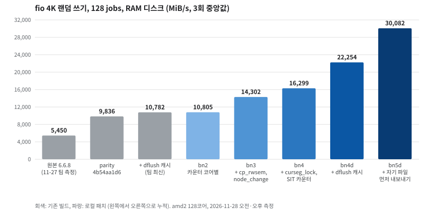
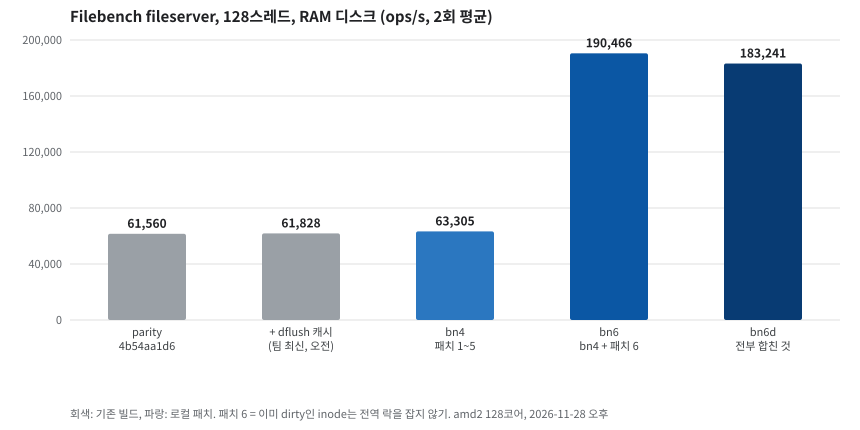

# DeLFS 7.2.8 포팅본 성능 개선: 모든 코어가 같이 쓰던 전역 값과 락 없애기

작성 2026-11-28 (오전 측정과 오후 후속 측정을 합친 기록). `DeLFS-성능실험-계획과-다음할일.md`의 "7.2 코드: 성능 — 남은 병목 후보"를 이어서 진행한 것임.

- 브랜치: GitHub `origin`의 `perf/b-next` 하나 (PR 없음, 2026-11-28). 기준은 `perf/delfs-7.2.8-parity` 끝 커밋 `4b54aa1d6`
  - 커밋 `2428623bb`까지: debugfs 수정 + 패치 1~6 + 이 문서 첫 판. dflush 동작은 그대로임. 서버 빌드 bn6와 같은 코드
  - 그 뒤 dflush 커밋 3개: 팀 dflush 캐시(`52148ed80`을 옮겨 온 `8b9a9237c`) + 수정안 2개(`150932f8d`, `9fbdd54ae`). 끝까지가 전부 합친 것이고, 서버 빌드 bn6d와 같은 코드
  - 처음에는 `perf/b-next`(패치 1~6)와 `perf/b-next-all`(전부) 두 브랜치로 올렸다가, 같은 날 하나로 합치고 `perf/b-next-all`은 GitHub에서 지웠음
  - 본문의 dflush 커밋 번호는 처음 작업할 때 번호임. GitHub에서는 `d48f39a8c` → `8b9a9237c`, `fa91c1759` → `150932f8d`, `8c304b1fe` → `9fbdd54ae`이고, bn6d(`da97f2c4e`)는 `perf/b-next` 끝과 코드가 같음
  - 이 문서와 그래프 2장은 `env-guide/perf-1128-percpu/`에 있음
- 서버 측정 원본: `/home/linux/delfs-port-728/runs/k728-bn-*`(오전), `k728-bn2-*`, `k728-bn3-*`(오후), `k728-q4-*`(저녁, SSD 포함)
- 작성자 PC 사본: `~/delfs/build/perf/lab-1128b/`(오전), `~/delfs/build/perf/lab-1128c/`(오후), `~/delfs/build/perf/lab-1128d/`(저녁). `~/delfs/...` 경로, 버그 목록(`DeLFS-버그목록.md`), 계획 문서는 작성자 PC에만 있음

---

## 1. 요약

128코어 서버에서 쓰기 경로가 **모든 코어가 같이 쓰는 전역 값(카운터·락)** 에 묶여 있었음. 프로파일로 하나씩 찾아서 코어별로 나누거나, 필요 없을 때는 잡지 않게 바꿈. 값의 의미와 락이 막아 주는 범위는 그대로임.

| 빌드 (서버 amd2, RAM 디스크) | fio 4K 랜덤 쓰기 128 jobs (MiB/s) | parity 대비 | Filebench fileserver 128스레드 (ops/s) | parity 대비 |
|---|---:|---:|---:|---:|
| 원본 6.6.8 (11-27 팀 측정) | 약 5,450 | 0.55 | — | |
| parity `4b54aa1d6` (기준) | 9,836 | 1.00 | 61,560 | 1.00 |
| parity + dflush 캐시 `52148ed80` (팀 최신) | 10,782 | 1.10 | 61,828 | 1.00 |
| 패치 1~5 (bn4) | 16,299 | 1.66 | 63,305 | 1.03 |
| 패치 1~5 + dflush 캐시 (bn4d) | 22,254 | 2.26 | 63,374 | 1.03 |
| 위 + dflush 수정안 2개 (bn5d) | **30,082** | **3.06** | — | |
| 패치 1~6 (bn6) | — | | **190,466** | **3.09** |
| **전부 합친 것 (bn6d)** | 30,278 (2회: 30,695 / 29,860) | 3.08 | 183,241 | 2.98 |

- 표의 값은 같은 날 세 번의 측정 큐에서 나온 것임. fio는 parity~bn4d가 오전 큐(3회 중앙값), bn5d가 오후 큐 2(3회 중앙값), bn6d가 오후 큐 3(2회 평균)임. 오후에 다시 잰 dflush1(10,758)과 bn4d(22,165)는 오전 값과 1% 안에서 같았음. fileserver는 팀 최신과 bn4d가 오전 큐(3회 중앙값), 나머지가 오후 큐 3(2회 평균)임. 저녁 큐 4에서 bn6와 bn6d fileserver를 4회씩 다시 쟀을 때도 191,366 / 191,012 ops/s(중앙값)로 같은 수준이었음.

**SSD (논문 조건: `jobs/rand-write.fio` 275GiB, 회차마다 NVMe Format, 저녁 큐 4, 같은 부팅에서 번갈아 2회)**

| 빌드 | 쓰기 (MiB/s) | parity 대비 | p99 | 디스크까지 다 쓴 속도 (MiB/s) | 커널 CPU |
|---|---:|---:|---:|---:|---:|
| 원본 6.6.8 (11-26·27 팀 측정, 다른 커널·부팅이라 참고용) | 4,527~4,881 | — | 41~46µs | 3,437~3,663 | — |
| parity `lab2a` | 4,862 (4,668 / 5,057) | 1.00 | 38 / 34µs | 3,546 (3,438 / 3,653) | 37~41% |
| **전부 합친 것 (bn6d = `perf/b-next` 끝)** | **6,077** (5,841 / 6,313) | **1.25** | **14 / 16µs** | **4,052** (3,993 / 4,111) | **13%** |

- SSD에서는 장치가 한계라 RAM 디스크(약 3배)만큼 벌어지지 않음. 그래도 2회 모두 bn6d가 빨랐고, 커널 CPU는 3분의 1로 줄었음. p99는 RAM 디스크와 달리 팀 기준(원본의 1.1배) 안임(8.5절).





효과가 컸던 것 세 가지

1. **전역 카운터 7개와 읽기 락 3개를 코어별로** (패치 3~5, 4장). fio에서 parity의 1.66배, 팀 dflush 캐시와 합치면 2.26배.
2. **dflush가 자기가 쓴 파일부터 내보내기** (7.4절). fio에서 다시 +36%(30,082 MiB/s). 로컬 VM(16코어)에서는 차이가 안 보였고 128코어에서만 드러났음.
3. **이미 dirty인 inode는 전역 락을 잡지 않기** (패치 6, 4.6절). fileserver는 CPU의 86%를 락 하나를 기다리는 데 쓰고 있었음. 이 락을 피하니 처리량이 3.1배가 됨.

그 밖에 확인한 것

- 128코어 데이터 검증(32GiB 쓰기 검증, 내용 모델 시험): bn4, bn4d2, bn5d, bn6, bn6d 모두 통과(6장).
- 스레드 수별: 64 jobs 1.9배, 32 jobs 1.18배, 1 job은 차이 없음(5.3절). 덮어쓰기는 +38%, 읽기는 같음(8.4절).
- YCSB A와 fsync fio는 회차 사이 편차가 커서 빌드 차이를 말할 수 없음. 나빠졌다는 신호는 없음(5.4절, 8.4절).
- bn4d 계열의 fio p99(약 142µs)는 팀 합격 기준을 넘음. 원인은 커널의 페이지 캐시 LRU 락이고 모듈 밖의 한계임(5.5절).
- 팀 dflush 캐시 커밋의 부작용(가끔 쓰는 스레드가 writeback을 떠맡음)을 서버에서도 확인했고, 수정안이 대부분 없앰(7장).
- **아직 다 못 푼 것:** fileserver와 YCSB에서 체크포인트가 가끔 수 초~34초 막힘. 팀의 fsync 노드 해시가 일부를 줄였음. 우리 빌드(bn6, bn6d)에서는 4초 안팎이 거의 매번 나옴(저녁에 4회씩 다시 재니 bn6 0.7~4.6초, bn6d 4.6~4.8초). 오후에 "bn6에서는 0.36초로 줄었다"고 본 것은 우연이었고, dflush 쪽 변경 탓도 아님. 막힌 동안 체크포인트 스레드는 `block_operations()` 첫 `f2fs_lock_all()`(패치 4의 코어별 `cp_rwsem` 쓰기 잠금)에서 기다리고 있었음. 원인은 아직 모름(8.3절, 버그 목록 #18).
- 패치 6 뒤 fileserver의 다음 한계도 fio와 같은 커널 LRU 락임(CPU의 70%, 8.2절).
- SSD 값은 위 표와 8.5절에 있음. 그 밖의 숫자는 모두 RAM 디스크 값임.

---

## 2. 배경: 왜 "같은 값을 여러 코어가 고치는 것"이 느린가

- CPU는 메모리를 64바이트 칸(캐시 라인) 단위로 자기 캐시에 복사해 두고 씀.
- 어떤 코어가 한 칸을 **고치면**, 다른 코어들이 가진 그 칸의 사본은 전부 무효가 됨. 다음에 그 칸을 쓰려는 코어는 고친 코어에게서 칸을 다시 받아 와야 함(수백 ns, 소켓이 다르면 더 김).
- 그래서 128개 코어가 같은 카운터 하나를 계속 `+1` 하면, 그 칸이 코어 사이를 끝없이 돌아다니고 코어들은 그걸 기다리며 시간을 보냄. 코어가 많을수록 심해짐.
- 팀의 캐시 라인 분리 커밋(`f62932776`, 서버 fio 2.05배)은 "자주 고치는 값"과 "읽기만 하는 값"을 다른 칸으로 떼어 놓은 것임(false sharing 제거). **자주 고치는 값 자체는 여전히 모든 코어가 같이 고침**(true sharing). 이번 작업은 그 남은 부분을 없앤 것임.

근거가 된 숫자:

- 서버 fio(128 jobs)에서 페이지 1개에 드는 CPU 시간은 약 49µs, 1 job일 때는 약 8.6µs임. 같은 일인데 코어가 많아지면 5.7배 비싸짐. 그 차이의 큰 부분이 캐시 칸을 기다리는 시간임.

---

## 3. 어디서 찾았나: 서버 프로파일을 함수 이름으로 풀기

- 팀원이 남긴 서버 프로파일(`runs/k728-perfhot-rec-lab2a`, `-dflush1`)에는 DeLFS 함수가 이름 없이 주소(`0xffffffffc1845fe5`)로만 찍혀 있었음(perf가 트리 밖 모듈의 심볼을 찾지 못함).
- 로컬에서 같은 소스(`4b54aa1d6`)를 같은 컴파일러(gcc 11.4.0)로 빌드하니 **함수 배치가 서버 빌드와 완전히 같았음.** 그래서 로컬 `delfs.ko`의 주소표로 서버 프로파일의 모든 주소를 함수 이름과 소스 줄로 풀 수 있었음.
  - 확인 방법: 호출 사슬 `f2fs_file_write_iter+0x316 → df_flush_deferred_writeback+0x1e9 → df_wb_writeback+0x180 → … → f2fs_write_end_io+0x1f`의 모든 주소가 로컬 빌드에서 정확히 `call` 명령 바로 다음 주소였음.
- 주의: 이 서버(EPYC 7713, Zen 3)의 `perf record` 기본 이벤트는 IBS라서, "함수 이름" 열과 "호출 사슬"이 서로 수백 명령어만큼 어긋나 있음. 그래서 함수별 % 대신 **"어느 `call` 아래에서 시간이 갔는가"(children %)** 와 **"인터럽트가 걸린 주소가 어느 `lock` 명령 바로 뒤인가"** 를 근거로 삼았음.

### 3.1 찾은 지점

parity(`lab2a`) 프로파일 기준임. 괄호는 dflush 캐시 빌드(`dflush1`) 프로파일 값임.

| # | 전역 값 | 누가 언제 고치나 | CPU 비율 | 처리 |
|---|---|---|---:|---|
| 1 | `cp_rwsem` 읽기 락 잡기 | writeback이 데이터 페이지마다 (`f2fs_trylock_op`) | 6.8% (8.0%) | 패치 4 |
| 2 | `cp_rwsem` 읽기 락 풀기 | 위와 짝 (`f2fs_unlock_op`) | 5.9% (7.5%) | 패치 4 |
| 3 | `node_change` 읽기 락 | `write()`마다 (`f2fs_map_blocks`) | 6.5% (7.1%) | 패치 4 |
| 4 | `curseg_lock` 읽기 락 | 블록 할당마다 (`f2fs_allocate_data_block`) | 4.7% (5.4%) | 패치 5 |
| 5 | `nr_pages[F2FS_DIRTY_DATA]` | `write()`에서 +1, writeback에서 −1 | −1 한 곳만 3.0% (3.5%) | 패치 3 |
| 6 | `nr_pages[F2FS_WB_DATA]` | 제출할 때 +1, 완료 때 −1 | (5와 같은 칸) | 패치 3 |
| 7 | `allocated_data_blocks` | 데이터 블록 할당마다 +1 | 약 1% | 패치 3 |
| 8 | `written_valid_blocks` | 블록 할당·무효화마다 | (4와 같은 구간) | 패치 5 |
| 9 | `discard_blks` | 블록의 discard 비트가 바뀔 때마다 | (4와 같은 구간) | 패치 5 |
| 10 | `block_count[]` (통계) | 블록 할당마다 `++` | (4와 같은 구간) | 패치 5 |
| 11 | `last_time[REQ_TIME]` 등 3개 | `write()`가 끝날 때마다 jiffies 저장 | 측정 못 함 | 패치 1 |
| 12 | `s_flag`의 `SBI_IS_DIRTY` | node·meta·inode 페이지가 dirty 될 때마다 `set_bit` | 측정 못 함 | 패치 2 |
| 13 | `wb->nr_threads` (커널 구조체) | `write()`마다 +1, −1 | 7.2% | 팀 `52148ed80`이 대부분 없앰 |
| 14 | `wb_over_bg_thresh()` 계산 | `write()`마다 | 9.4% | 팀 `52148ed80`이 없앰 |

- 1~10은 원본 6.6.8 DeLFS에도 똑같이 있음. 포팅에서 생긴 문제가 아니라 원본 설계에 남아 있던 부분임.
- 13, 14는 팀원(sopp1313)의 dflush 캐시 커밋이 이미 다룸. 이번 패치와 겹치지 않음.

---

## 4. 패치

커밋 순서대로임. 한 커밋에 한 가지만 넣어서, 단계별 빌드(bn1~bn4)로 효과를 따로 잴 수 있게 했음.

| 빌드 | 커밋 | 내용 |
|---|---|---|
| (공통) | `dc8011964` | debugfs `status` 패닉 수정(`db26188d8`)을 그대로 가져옴. 성능과 무관. 공유 서버에서 누가 실수로 읽어도 죽지 않게 하려는 것 |
| bn1 | `1750189bb` | 패치 1: 같은 시각을 다시 저장하지 않기 |
| bn1 | `367d5c35c` | 패치 2: 이미 켜진 `SBI_IS_DIRTY`를 다시 쓰지 않기 |
| bn2 | `c61d984bf` | 패치 3: 데이터 페이지 수, 할당 블록 수를 코어별로 |
| bn3 | `19a77b594` | 패치 4: `cp_rwsem`, `node_change`를 코어별 rwsem으로 |
| bn4 | `8dce3d757` | 패치 5: `curseg_lock`을 코어별 rwsem으로, SIT 블록 카운터를 코어별로 |
| bn4d | + `52148ed80` | bn4에 팀 dflush 캐시 커밋을 얹은 합본 |
| bn6 | `e8350ae18` | 패치 6: 이미 dirty인 inode는 전역 락을 잡지 않기 (오후 후속 측정에서 찾아서 추가함, 4.6절) |

### 4.1 패치 1: 같은 시각을 다시 저장하지 않기

```c
static inline void f2fs_update_time(struct f2fs_sb_info *sbi, int type)
{
	unsigned long now = jiffies;

	if (READ_ONCE(sbi->last_time[type]) != now)
		WRITE_ONCE(sbi->last_time[type], now);
	...
```

- 원래 역할: "마지막으로 요청이 온 시각"을 기록함. GC·discard 스레드가 "지금 한가한가"를 볼 때 씀.
- 문제: `write()`가 끝날 때마다 불리는데, 값(jiffies)은 4ms에 한 번만 바뀜. 같은 값을 다시 써도 CPU는 그 칸을 독점하려고 다른 코어에서 뺏어 옴.
- 바꾼 점: 값이 다를 때만 저장함. 저장되는 값은 전과 같음.

### 4.2 패치 2: 이미 켜진 dirty 플래그를 다시 쓰지 않기

```c
	if ((count_type == F2FS_DIRTY_DENTS || ... ) &&
			!is_sbi_flag_set(sbi, SBI_IS_DIRTY))
		set_sbi_flag(sbi, SBI_IS_DIRTY);
```

- 원래 역할: 메타데이터가 dirty 되면 "체크포인트가 필요함" 플래그를 켬.
- 문제: `set_bit`은 이미 켜져 있어도 쓰기로 처리됨. `s_flag`는 쓰기 경로가 페이지마다 읽는 칸(`s_flag`, `oldinv` 포인터)에 있음.
- 바꾼 점: 꺼져 있을 때만 켬. 개수를 먼저 올리고 플래그를 확인하므로, 체크포인트가 플래그를 지운 뒤 dirty 개수를 다시 확인하는 기존 절차에서 빠지지 않음.

### 4.3 패치 3: 데이터 페이지 수와 할당 블록 수를 코어별로

```c
struct f2fs_pcpu_cnt {
	long nr_pages[NR_F2FS_PCPU_PAGES];	/* DIRTY_DATA, WB_DATA, RD_DATA */
	unsigned long long allocated_data_blocks;
	...
};

static inline void inc_page_count(struct f2fs_sb_info *sbi, int count_type)
{
	int type = f2fs_pcpu_page_type(sbi, count_type);

	if (type >= 0) {
		this_cpu_inc(sbi->pcpu_cnt->nr_pages[type]);
		return;
	}
	atomic_inc(&sbi->nr_pages[count_type]);
	...
}
```

- 원래 역할: 파일시스템 전체의 "dirty 데이터 페이지 수", "쓰는 중인 페이지 수", "읽는 중인 페이지 수"를 셈.
- 바꾼 점: 이 세 개는 코어마다 따로 세고, 읽을 때 전부 더함(`get_pages()`).
  - 올리는 코어와 내리는 코어가 달라도 됨. 합만 맞으면 됨.
  - 읽는 곳은 umount 때 누수 검사, "진행 중 I/O가 있나" 검사, checkpoint 끄기 전 flush, debugfs뿐임. 페이지마다 읽는 곳은 없음.
  - 합을 읽는 순간 다른 코어가 고치는 중이면 몇 개 어긋날 수 있어서, 음수가 되지 않게 0으로 자름. 고치는 중이 아닐 때는 정확함.
- 그대로 둔 것:
  - dirty node·dentry·imeta 수는 빈 공간 검사가 `write()`마다 읽으므로 원래대로 atomic으로 둠.
  - LFS 모드(`mode=lfs`)로 mount하면 `F2FS_DIRTY_DATA`도 원래대로 atomic을 씀. 그 모드에서는 빈 공간 검사가 이 값을 `write()`마다 읽기 때문임.
- `allocated_data_blocks`: block age extent cache의 시계로만 쓰임. `age_extent_cache` 옵션을 켠 mount는 전과 똑같이 동작하고, 끈 mount(기본값)에서는 코어별로 세고 debugfs가 합을 보여 줌. 이 옵션은 remount로 바꿀 수 없음.

### 4.4 패치 4: `cp_rwsem`, `node_change`를 코어별 rwsem으로

```c
struct f2fs_pcpu_rwsem {
	struct f2fs_rwsem __percpu *sem;	/* 코어마다 rwsem 하나 */
	atomic_t writers;			/* 쓰는 쪽이 들어오는 중이면 0이 아님 */
};

int f2fs_pcpu_down_read_trylock_trace(struct f2fs_pcpu_rwsem *ps,
						struct f2fs_lock_context *lc)
{
	if (unlikely(atomic_read(&ps->writers)))
		return 0;

	lc->cpu = raw_smp_processor_id();
	return f2fs_down_read_trylock_trace(pcpu_rwsem_of(ps, lc->cpu), lc);
}

void f2fs_pcpu_down_write(struct f2fs_pcpu_rwsem *ps, struct f2fs_rwsem *nest_lock)
{
	atomic_inc(&ps->writers);
	for_each_possible_cpu(cpu)
		down_write(...);	/* 모든 코어의 rwsem을 낮은 번호부터 */
}
```

- 원래 역할:
  - `cp_rwsem`: 체크포인트가 도는 동안 파일시스템 작업을 멈춤. 작업 쪽은 읽기로, 체크포인트는 쓰기로 잡음.
  - `node_change`: 체크포인트가 node 페이지를 모으는 동안 `write()`의 블록 예약을 멈춤.
- 문제: rwsem은 "읽는 쪽이 몇 명인가"를 한 칸에 적음. 읽기로 잡고 풀 때마다 모든 코어가 그 칸을 고침. `cp_rwsem`은 페이지마다, `node_change`는 `write()`마다 잡힘.
- 바꾼 점: rwsem을 코어마다 하나씩 둠.
  - 읽는 쪽은 자기 코어의 rwsem만 잡음. 어느 코어 것을 잡았는지는 락 컨텍스트(`lc->cpu`)에 적어 두고, 풀 때 그걸 품. 7.2.8 코드는 잡을 때와 풀 때 같은 `lc`를 넘기게 이미 되어 있음(락 추적 기능이 그걸 요구함). 106곳을 전부 확인했음.
  - 쓰는 쪽(체크포인트)은 모든 코어의 rwsem을 순서대로 잡음. 체크포인트 1회에 수십 µs가 더 들 뿐임.
  - `writers` 표시: 쓰는 쪽이 들어오기 시작하면 trylock은 바로 실패하고(원래 rwsem도 쓰는 쪽이 기다리면 trylock이 실패함), 기다리는 읽기는 쓰는 쪽이 첫 번째로 잡는 rwsem 앞에 줄을 섬. 그래서 체크포인트는 "이미 들어와 있던 읽는 쪽"만 기다림.
- `percpu_rw_semaphore`(커널 표준)를 쓰지 않은 이유: 쓰는 쪽이 잡을 때마다 RCU grace period(이 서버에서 10~40ms)를 기다림. fsync가 체크포인트를 부르는 워크로드에서 지연이 그대로 늘어남. 이를 피하는 `rcu_sync_enter()`는 모듈에 export되어 있지 않음.
- 그대로인 것: 읽는 쪽이 막는 것과 쓰는 쪽이 막는 것, 락 이름, 추적·우선순위 올리기·fault injection.

### 4.5 패치 5: `curseg_lock`과 SIT 블록 카운터

```c
	int lock_cpu;	/* 어느 코어의 curseg_lock을 잡았나 */

	f2fs_pcpu_down_read(&SM_I(sbi)->curseg_lock, &lock_cpu);
	...
	f2fs_pcpu_up_read(&SM_I(sbi)->curseg_lock, lock_cpu);
```

```c
	/* update_sit_entry() */
	this_cpu_add(sbi->pcpu_cnt->written_valid_blocks, del);
```

- `curseg_lock`: 블록 할당 중에 현재 세그먼트가 바뀌지 않게 막음. 할당은 읽기로, `f2fs_do_replace_block()`(복구와 범위 ioctl)만 쓰기로 잡음. 패치 4의 구조체를 그대로 씀. 읽는 쪽이 `lc`를 안 쓰는 곳이라 코어 번호를 지역 변수에 둠.
- `written_valid_blocks`, `discard_blks`, `block_count[]`: 블록을 할당하거나 무효화할 때마다 바뀌는 카운터임. mount 때 SIT에서 계산한 값은 그대로 두고, 이후 변화량만 코어별로 셈. 읽는 곳은 GC 스레드의 잠자는 시간 계산, "discard할 것이 남았나" 검사(trim·checkpoint·umount), debugfs임.

### 4.6 패치 6: 이미 dirty인 inode는 전역 락을 잡지 않기

```c
int f2fs_inode_dirtied(struct inode *inode, bool sync)
{
	struct f2fs_sb_info *sbi = F2FS_I_SB(inode);
	int ret = 0;

	smp_mb();
	if (is_inode_flag_set(inode, FI_DIRTY_INODE) &&
	    (!sync || !data_race(list_empty(&F2FS_I(inode)->gdirty_list))))
		return 1;			/* 바꿀 것이 없음: 락 없이 돌아감 */

	spin_lock(&sbi->inode_lock[DIRTY_META]);	/* 여기부터는 원래 코드 그대로 */
	...
```

```c
	/* f2fs_inode_synced(): dirty 표시를 지우는 쪽 */
	clear_inode_flag(inode, FI_DIRTY_INODE);
	clear_inode_flag(inode, FI_AUTO_RECOVER);
	smp_mb__after_atomic();		/* 위 smp_mb()와 짝 */
```

- 원래 역할: inode의 메타데이터(파일 크기, 블록 수, 시각 등)가 바뀌면 "dirty" 표시를 하고 dirty inode 목록에 넣음. 체크포인트가 이 목록을 돌면서 inode 내용을 node 페이지로 옮김.
- 문제: 이 표시와 목록을 지키는 락(`sbi->inode_lock[DIRTY_META]`)이 파일시스템 전체에 하나임. 그런데 이미 dirty이고 목록에도 들어 있어서 바꿀 것이 없을 때도 매번 이 락을 잡았음. 파일 크기가 늘어나는 `write()`는 호출할 때마다 여기로 옴(`f2fs_write_end → f2fs_i_size_write → f2fs_mark_inode_dirty_sync`).
  - 찾은 경위: 후속 측정의 fileserver 프로파일(128스레드, 기준 빌드). **CPU 시간의 86%가 이 락을 기다리는 스핀이었음**(8.2절). fio 랜덤 쓰기는 미리 만든 파일 안에서만 써서 파일 크기가 안 바뀌므로 드러나지 않았음.
  - upstream F2FS와 원본 6.6.8 DeLFS도 같은 코드임.
- 바꾼 점: 이미 dirty이고 (목록에 넣어 달라는 호출이면) 목록에도 있을 때는 락 없이 돌아감. 실제로 상태가 바뀌는 경우에는 전과 똑같이 락을 잡음.
- 갱신을 놓치지 않는 이유:
  - 부르는 쪽은 항상 값을 먼저 바꾸고(예: 파일 크기 저장) 그다음에 이 함수를 부름.
  - 지우는 쪽(`f2fs_update_inode`)은 dirty 표시를 먼저 지우고 그다음에 inode 값을 읽어서 node 페이지에 옮김.
  - 양쪽 모두 "쓰기 → 메모리 장벽 → 읽기" 순서가 되도록 장벽을 넣었음(`smp_mb()`, `smp_mb__after_atomic()`). 그래서 둘 중 하나는 반드시 성립함: 이 함수가 "표시가 이미 지워졌음"을 보고 락을 잡아 다시 표시하거나, 지우는 쪽이 새 값을 읽어 감.
- 로컬 VM 시험(16 vCPU): 기본·다중 코어·스트레스·전원 차단(2회: fsync가 끝난 파일 1,683개, 1,266개 모두 정상) 통과. 스트레스 시험의 메타데이터 반복 횟수가 30초에 약 7,000회에서 26,801회로 늘었음.

---

## 5. 서버 측정 결과

- 서버: amd2 (EPYC 7713 × 2, 128코어), 커널 7.2.8-delfs, 2026-11-28 11:41~13:06
- 방법: 팀 도구 그대로임. `bin/series.sh`가 빌드를 번갈아 돌리고 회차마다 시작 순서를 바꿈. 미리 채운 100GiB RAM 디스크, SSD는 쓰지 않았음.
- 큐 스크립트: `bin/queue-k728-bnext.sh` (새 파일. 팀 스크립트는 고치지 않았음)

### 5.1 fio 4K 랜덤 쓰기, 128 jobs × 600MiB (`jobs/rand-write-600m.fio`), 3회

| 빌드 | 쓰기 MiB/s (1/2/3회) | 중앙값 | 기준 대비 | dflush1 대비 | p99 (µs) | 디스크까지 다 쓴 속도 | 가장 긴 write() |
|---|---|---:|---:|---:|---|---|---|
| parent = parity `4b54aa1d6` | 9,991 / 9,836 / 9,755 | 9,836 | 1.00 | 0.91 | 36 / 35 / 36 | 2,796 / 2,686 / 2,815 | 0.6~0.7초 |
| dflush1 = + `52148ed80` | 10,656 / 10,866 / 10,782 | 10,782 | 1.10 | 1.00 | 28 / 27 / 27 | 2,587 / 2,713 / 2,703 | 0.7~0.8초 |
| bn1 (패치 1, 2) | 10,131 / 9,953 / 9,783 | 9,953 | 1.01 | 0.92 | 34 / 36 / 36 | 2,710 / 2,987 / 2,933 | 0.6~0.7초 |
| bn2 (+ 패치 3) | 11,046 / 10,726 / 10,805 | 10,805 | 1.10 | 1.00 | 30 / 32 / 35 | 2,766 / 2,708 / 2,945 | 0.5~0.6초 |
| bn3 (+ 패치 4) | 14,414 / 14,302 / 14,162 | 14,302 | 1.45 | 1.33 | 36 / 37 / 35 | 3,112 / 2,775 / 2,945 | 0.4초 |
| bn4 (+ 패치 5) | 16,613 / 16,299 / 16,091 | 16,299 | 1.66 | 1.51 | 39 / 35 / 37 | 3,240 / 3,073 / 3,109 | 0.3초 |
| **bn4d (+ `52148ed80`)** | **21,233 / 22,973 / 22,254** | **22,254** | **2.26** | **2.06** | 142 / 142 / 146 | 3,294 / 3,371 / 3,102 | 0.3초 |

- 21회 모두 실패와 커널 경고가 없었음.
- 원본 6.6.8(같은 조건 5,381~5,518)과 비교하면 bn4는 약 3.0배, bn4d는 약 4.1배임.
- 패치 1, 2(bn1)는 효과가 측정되지 않았음(기준과 같은 범위). 해가 없는 변경이라 남겨 두되, 근거가 약하므로 빼도 됨.
  - 패치 1이 고친 것은 단순 저장(`mov`)임. 단순 저장은 CPU의 store buffer가 받아 두고 뒤에서 처리해서, 칸을 뺏어 오는 동안에도 실행이 멈추지 않음. 반면 카운터 `+1`이나 락(`lock` 접두 명령)은 칸을 독점할 때까지 멈춤. 그래서 같은 "전역 쓰기"라도 비용이 크게 다름.
- 효과가 큰 것은 패치 4(락 2개, +32%), 패치 5(할당 경로, +14%), 패치 3(카운터, +10%) 순임.
- dflush 캐시(`52148ed80`)는 parity 위에서는 +10%인데 bn4 위에서는 +37%임. 다른 전역 값이 사라지고 나니 `write()`마다 하던 기준선 검사가 남은 가장 큰 비용이었기 때문임.
- "디스크까지 다 쓴 속도"는 2,800 → 3,300 정도로만 오름. 마지막 `sync`(약 20초)가 flusher 스레드 하나로 14GiB를 내보내는 구간이라 쓰기 스레드 수와 무관하기 때문임.

**bn4d의 p99가 커진 이유.** `write()` 한 번에 걸린 시간의 분포(3회 중앙값)는 다음과 같음.

| 빌드 | 평균 | p50 | p90 | p95 | p99 | p99.9 |
|---|---:|---:|---:|---:|---:|---:|
| parent | 45.9µs | 18.0 | 25.7 | 28.5 | 35.6 | 95 |
| dflush1 | 41.7µs | 13.8 | 19.1 | 21.1 | 27.3 | 91 |
| bn2 | 40.0µs | 14.8 | 21.4 | 24.2 | 31.6 | 153 |
| bn3 | 32.1µs | 13.5 | 20.9 | 24.2 | 36.1 | 122 |
| bn4 | 28.0µs | 13.8 | 21.1 | 24.7 | 36.6 | 110 |
| bn4d | **20.2µs** | **4.0** | **5.2** | 7.3 | 142.3 | 159 |

- bn4d에서는 `write()`의 95%가 7.3µs 안에 끝나고 평균도 절반 이하임(기준은 p95 28.5µs, 평균 45.9µs). 대신 2.1~2.4%가 약 145µs에 몰려 있어 p99만 커짐.
- 원본 6.6.8의 p99는 같은 조건에서 41~42µs임(11-27 팀 측정). bn4는 35~39µs로 그보다 낮고, bn4d만 높음.
- 원인은 커널의 페이지 캐시 LRU 락 대기임(5.5절).

### 5.2 Filebench fileserver (30초, 파일 12,800개, 평균 1MiB, 128스레드), 3회

| 빌드 | ops/s (1/2/3회) | 중앙값 | 기준 대비 | "체크포인트 5초 넘게 대기" 경고 |
|---|---|---:|---:|---|
| parent | 61,484 / 61,970 / 60,855 | 61,484 | 1.00 | 3회 중 2회 |
| dflush1 | 60,804 / 61,828 / 61,866 | 61,828 | 1.01 | 3회 중 1회 |
| bn4 | 63,456 / 63,997 / 63,321 | 63,456 | 1.03 | 없음 |
| bn4d | 63,685 / 63,239 / 63,374 | 63,374 | 1.03 | 없음 |

- bn4·bn4d의 6회가 모두 parent·dflush1의 6회보다 높음(63,239~63,997 대 60,804~61,970).
- 경고는 `f2fs_issue_checkpoint()`가 체크포인트 요청이 5초 넘게 걸리면 찍는 `blocked on checkpoint for N ms`임. 팀의 이전 fileserver 측정에서도 parity 계열은 대부분의 회차에서 찍혔음.
- **실행 중 128코어 가운데 약 125코어가 커널(system) 시간으로 차 있었음**(user는 0.4코어). 빌드 4개가 모두 같음. 초당 6만 연산에 CPU 125개를 쓰는 것이라 연산 하나에 CPU 2ms가 듦. 오후 후속 측정에서 프로파일을 떠 보니 **이 시간의 대부분(전체 CPU의 86%)이 전역 락 하나를 기다리는 스핀**이었음(8.2절). 패치 1~5가 없앤 전역 값들은 이 워크로드의 주된 비용이 아니었고, 그래서 효과가 +3%에 그쳤던 것임. 이 락을 피하는 패치 6을 추가했음(4.6절).
- 경고가 난 3회는 모두 체크포인트의 **1단계(`block_operations()`: 파일시스템 작업을 멈추고 dentry·inode·node를 내보내는 단계)** 에서 시간이 갔음: 6.1초 / 10.0초 / 11.9초. 나머지 단계는 합쳐서 0.04초임. 팀 측정분까지 일곱 번을 보면, 막힌 길이와 상관없이 모두 측정 시작 약 26초 뒤(실행의 16초 지점)에 풀렸음. bn4·bn4d의 6회에는 5초를 넘긴 체크포인트가 없었음. YCSB에서도 같은 경고가 parity 계열에서만 나왔음(5.4절). **(오후 정정: 우연이었음. 오후 측정에서는 bn4에서도 12.6초가 나왔음. 8.3절 참고)**

### 5.3 스레드 수별 (같은 75GiB를 N개가 나눠 씀, `jobs/scale-N.fio`), 2회

| writers | dflush1 MiB/s | bn4d MiB/s | bn4d / dflush1 | p99 (dflush1 → bn4d) |
|---:|---|---|---:|---|
| 128 | 10,782 (3회 중앙값) | 22,254 (3회 중앙값) | 2.06 | 27 → 142µs |
| 64 | 9,820 / 9,740 | 18,334 / 18,902 | 1.90 | 18~22 → 46~92µs |
| 32 | 8,118 / 7,565 | 9,618 / 8,887 | 1.18 | 14~15 → 15~17µs |
| 16 | 4,857 / 4,476 | 5,781 / 4,981 | 1.15 | 10~11 → 11µs |
| 1 | 474 / 492 | 479 / 480 | 0.99 | 9 → 9µs |

- 스레드가 적을 때 손해가 없고, 많을수록 이득이 커짐. 전역 값을 뺏고 뺏기는 비용이 줄었다는 것과 맞는 모습임.
- 1스레드는 그대로임. 원본(543)과의 1스레드 차이는 이번 패치로 줄지 않음.
- p99가 커지는 것은 64개 이상에서만임.

### 5.4 YCSB A (RocksDB, 레코드 100만 개 × 40KB, 연산 64만 번, 32스레드), 2회

| 빌드 | ops/s (1/2회) | load ops/s | run 단계에서 거의 멈춘 시간 | 멈춘 시간을 뺀 ops/s | 오류, ENOSPC | 5초 넘게 막힌 체크포인트 |
|---|---|---|---|---|---|---|
| dflush1 | 4,541 / 5,076 | 3,683 / 3,951 | 60초 / 46초 | 8,000 / 8,000 | 없음 | 1회차 load 중 1번 (33.9초) |
| bn4d | 5,014 / 6,910 | 3,998 / 3,917 | 50초 / 2초 | 8,312 / 7,111 | 없음 | 없음 |

- "거의 멈춘 시간"은 10초 단위 처리량이 1,500 ops/s 아래인 구간의 합임(`lab-1128/tools/ycsb_stalls.py`).
- **두 빌드의 차이는 말할 수 없음.** ops/s는 run 단계에서 몇 초 멈췄는가가 정함. 멈춘 구간을 빼면 둘 다 7,100~8,300 ops/s임. 팀이 먼저 본 것(같은 빌드도 4,615~10,238로 흔들림)과 같은 모습임.
- bn4d가 나빠졌다는 신호는 없음. 4회 모두 실패한 연산 0건, ENOSPC 0건임.
- 멈춘 구간의 모습: 128코어 중 user 0.6 + system 0.7코어만 쓰이고 있었음. 스레드 하나가 도는 양임. RocksDB의 compaction 스레드가 밀린 일을 처리하는 동안 RocksDB가 스스로 쓰기를 멈춘 것으로 보임. 양쪽 빌드에 다 나타남.
- **새로 본 것:** dflush1 1회차의 load 단계에서 체크포인트가 33.9초 막혔음(그중 33.85초가 1단계 `block_operations()`). 그 34초 동안 YCSB 처리량은 0에 가까웠고, 서버 전체에서 커널 스레드 하나만 CPU를 쓰고 있었음(user 0.0, system 1.0~1.1코어). RocksDB flush 스레드가 `fsync`에서 이 체크포인트를 기다리는 호출 경로가 커널 로그에 찍혔음. load 단계라서 위 표의 ops/s(run 단계 값)에는 들어가지 않음.
  - 같은 종류의 경고가 fileserver에서도 parity 계열에서만 나옴(5.2절). 서버에 있는 팀 측정분까지 합치면 fileserver는 parity 계열 10회 중 7회, bn4·bn4d는 6회 중 0회임.
  - 원인은 아직 확인하지 못했음. 오후 측정에서는 우리 패치 빌드에서도 나왔으므로(8.3절) "우리 패치에서는 안 나온다"는 것은 사실이 아님. 버그 목록 #18에 기록했음. 세는 도구: `lab-1128b/tools/cp_blocked.py`, 시간대별로 보는 도구: `lab-1128b/tools/ycsb_cpu_timeline.py`

### 5.5 bn4d의 p99가 커진 원인: 커널의 페이지 캐시 LRU 락 (후속 측정에서 확인)

**결론.** bn4d의 `write()` 중 약 2.4%가 145µs 근처에 몰리는 것은 **커널 메모리 관리의 LRU 락(`lruvec->lru_lock`)을 기다리는 시간**임. 모듈 코드가 아니라 커널 쪽 한계임.

근거 1, 실행 중 프로파일 (후속 큐, bn4d fio 128 jobs, 시작 1초 뒤부터 2초, 표본 39,000개)

| CPU 시간 | 어디서 |
|---:|---|
| 20.4% | `write()` → `f2fs_write_begin` → 새 페이지를 페이지 캐시에 넣기 → `folio_add_lru` → **`folio_lruvec_lock_irqsave`에서 스핀락 대기** |
| 17.9% | 쓰기 경로의 나머지(페이지 캐시 조회·할당·삽입, 데이터 복사, dirty 표시) |
| 6.3% | 쓰기 전 블록 예약(`f2fs_map_blocks`) |
| 44.7% | `write()` 뒤 dflush가 하는 writeback (그중 bio 제출 13.8%: RAM 디스크로 복사 6.2% 포함, node 페이지 찾기 약 8%) |

- 호출 경로: `pwrite64 → f2fs_file_write_iter → df_generic_perform_write → f2fs_write_begin → __filemap_get_folio → filemap_add_folio → folio_add_lru → folio_batch_move_lru → folio_lruvec_lock_irqsave → native_queued_spin_lock_slowpath`
- 커널은 새 페이지를 LRU 목록에 넣을 때 코어마다 31개씩 모았다가 한 번에 넣음. 이때 잡는 락이 cgroup × NUMA 노드마다 하나뿐이라, fio 128개가 한 cgroup에 있으면 락 2개를 64코어씩 나눠 씀. bn4d는 초당 570만 페이지를 새로 넣으므로 이 락에 줄이 생김.
- "31번에 1번(3.2%)" 가운데 줄을 서게 되는 경우가 2.4%로 측정된 것임.

근거 2, fio가 남긴 지연 구간별 비율

| 조건 | 100~250µs에 든 `write()` 비율 | 그 묶음의 위치 | 1ms 이상 |
|---|---|---|---:|
| bn4d, 128 jobs (첫 큐 3회) | 2.1 / 2.4 / 2.4% | p99 142~146µs, p99.9 159~163µs | 0.08% |
| bn4d, 128 jobs (후속 큐 3회) | 2.4 / 2.5 / 2.6% | p99 144~146µs | 0.08~0.09% |
| bn4d2, bn4dj, bn5d (후속 큐, 3회씩) | 2.0~2.6% | p99 136~144µs | 0.06~0.08% |
| bn4d, 64 jobs (2회) | 0.9 / 0.6% (50~100µs에 0.4 / 0.3% 더 있음) | p99.5 122~123µs, p99.9 138~142µs | 0.07% |
| bn4d, 32 jobs 이하 | 0.02~0.03% | 없음 | 0.09~0.12% |
| bn4, 128 jobs | 0.06~0.08% | 없음 | 0.08~0.09% |
| parent·dflush1, 128 jobs | 0.02~0.04% | 없음 | 0.09~0.11% |

- dflush 캐시가 없는 빌드(bn4, parent)는 `write()`마다 기준선 검사에 10µs쯤 쓰느라 새 페이지를 이만큼 빨리 넣지 못해서, 이 락에 줄이 생기지 않았던 것임.
- 1ms가 넘는 `write()`(writeback을 직접 떠맡은 경우)의 비율은 모든 빌드에서 같음.

기각한 가설: dflush 캐시의 만료 시점

- 캐시가 모든 코어에서 같은 tick에 만료되어 한꺼번에 검사로 몰리는 것이 원인일 수 있다고 보고, 만료 시점을 코어마다 다르게 한 실험 빌드(bn4dj, 7.5절)를 만들어 쟀음.
- 결과: bn4d와 같았음(처리량 22,037 대 22,165 MiB/s, p99 136~144 대 144~146µs, 느린 쓰기 비율 2.1~2.6%). 위 프로파일에도 dflush 쪽 락 대기는 보이지 않았음. **이 가설은 틀렸음.**

뜻하는 바

- RAM 디스크에서 bn4d 계열의 p99는 파일시스템이 아니라 커널 LRU 락이 정함. 팀 합격 기준(p99가 원본의 1.10배 이하)을 RAM 디스크 fio 128 jobs에 그대로 적용하면, 쓰기가 빨라질수록 오히려 불합격이 됨. 이 조건의 p99는 기준에서 빼거나, fio job마다 cgroup을 따로 주어(락이 job마다 생김) 재는 방법을 팀과 상의할 만함.
- CPU의 20%가 이 락에서 쓰이므로, RAM 디스크에서 쓰기 처리량을 더 올리는 데도 걸림돌임. 모듈에서 할 수 있는 일은 큰 folio를 쓰는 것 정도인데 범위가 큼.
- 실제 SSD에서는 장치가 먼저 한계가 되어 초당 570만 페이지에 이르지 못하므로 나타나지 않을 가능성이 큼(재 봐야 앎).
- 서버의 perf에는 `perf lock` 기능이 빠져 있어서 락 대기 시간을 직접 재지는 못했음. 위 결론은 CPU 프로파일의 호출 경로로 내린 것임.

---

## 6. 정확성 확인

### 6.1 우리 VM (16 vCPU, 7.2.8-delfs)

로컬 빌드 이름은 서버 이름에서 `b`를 뺀 것임(n4 = bn4, n4d = bn4d, n4d2 = bn4d2, n5d = bn5d, n6 = bn6, n6d = bn6d).

| 시험 | 내용 | n4d | n4d2 | n5d | 기준(parity) |
|---|---|---|---|---|---|
| `m1-test-any.sh` | 1코어 쓰기, remount 뒤 체크섬 비교 | 통과 | 통과 | 통과 | — |
| `multicore-check-any.sh` | 16코어 동시 쓰기 + 검증 + remount | 통과 | 통과 | 통과 | — |
| `fio-order-test.sh` | 할당 순서 버그 재현 시험 2회 | 통과 | — | 통과 | — |
| `stress-cp.sh` (새로 만듦) | fio 덮어쓰기 + `sync` 반복 + 파일 생성·fsync·이름 바꾸기·자르기·삭제 8개를 동시에 20~40초, remount 뒤 체크섬·파일 수 비교 | 통과 | 통과 | 통과 | 통과 |
| `crash-check.sh` (새로 만듦) | fsync 쓰기 8개 + fio + `sync` 반복 중에 VM을 갑자기 끄고, 다시 켜서 mount(복구)한 뒤 fsync가 끝났던 파일을 전부 검사 | n4 1회: 2,469개 모두 정상 | — | 2회: 2,415개, 3,093개 모두 정상 | 2회: 2,378개, 3,017개 모두 정상 |
| `gc-check.sh` | 20GB 볼륨에 덮어쓰기 반복 | 4단계에서 빈 세그먼트 소진 (n3d) | — | — | 3단계에서 소진 |
| 체크포인트가 잦은 fio (16 jobs, 35GB 파일) | 커널 경고 없음, 명령어 수 (n3d) | 8.2~8.6G/GiB | — | — | 8.8~9.5G/GiB |

오후에 추가한 빌드의 같은 시험

| 빌드 | 기본·다중 코어 | `stress-cp.sh` | `crash-check.sh` (2회) |
|---|---|---|---|
| n6d (전부 합친 것, 패치 6 포함) | 통과 | 통과 (30초에 메타데이터 반복 26,801회) | fsync가 끝난 파일 1,683개 / 1,266개 모두 정상 |
| n6 (패치 1~6) | — | 통과 (20초에 19,480회) | — |
| n4dj (7.5절 실험) | 통과 | 통과 | — |
| n4dh (bn4d + 팀의 fsync 노드 해시, 조합 확인용) | 통과 | 통과 2회 (30초에 6,090회, 20초에 4,464회) | 2,453개 / 3,026개 모두 정상 |

- `gc-check.sh`의 빈 세그먼트 소진은 버그 목록 #16(원본에도 있음)임. 기준 빌드가 오히려 한 단계 먼저 소진됨. 이번 변경과 무관함.
- VM은 CPU가 1개(16스레드)라 캐시 칸 이동 비용이 거의 안 보임. 그래도 명령어 수가 5% 안팎 줄었음.

### 6.2 서버 (128코어)

- **데이터 검증: 통과** (11-28 오후, 큐 2와 큐 3의 첫 단계, 팀 도구 `bin/verify-run.sh`와 `bin/model-run.sh`).

  | 빌드 | 쓰기 검증 (128 jobs × 256MiB = 32GiB, crc32c) | 내용 모델 시험 (파일 16개) |
  |---|---|---|
  | bn4 | 같은 mount에서 오류 0줄, remount 뒤 오류 0줄 | 실행 OK, remount OK |
  | bn4d2 | 오류 0줄 / 0줄 | OK / OK |
  | bn5d | 오류 0줄 / 0줄 | OK / OK |
  | bn4dj (7.5절 실험 패치) | 오류 0줄 / 0줄 | OK / OK |
  | bn6 (패치 1~6) | 오류 0줄 / 0줄 | OK / OK |
  | bn6d (전부 합친 것) | 오류 0줄 / 0줄 | OK / OK |

  여섯 빌드 모두 이 검증 중에는 커널 경고가 없었음(`dmesg_flags=0`). bn4d는 따로 돌리지 않았음(bn4d2·bn5d·bn4dj·bn6d가 모두 bn4d 위에 얹은 빌드임).
- 팀의 복구 4종 시험(`env-guide/scripts/parity-recovery-test.py`)은 한빈님 VM 환경이 필요해서 돌리지 못했음.

---

## 7. dflush 캐시 커밋(`52148ed80`)의 부작용과 수정안

팀원(sopp1313)의 dflush 캐시 커밋은 fio에서 확실히 빠름(이번 측정에서도 parity 위에서 +10%, bn4 위에서 +37%). 그런데 우리 VM 시험에서 **가끔 조금씩 쓰는 스레드가 writeback을 떠맡는** 부작용이 보였음. 7.1절은 우리 VM(16 vCPU, HZ=250) 값이고, 서버(128코어)에서 확인한 값은 7.3절 끝에 있음.

### 7.1 현상

`smallwrite-test.sh`(새로 만듦): fio 4K 랜덤 쓰기 8개가 도는 옆에서, 프로세스 하나가 2ms마다 4KiB를 쓰고 그 `write()`에 걸린 시간을 15초 동안 잼.

| 빌드 | 쓴 횟수 | write() 안에서 보낸 시간 | 가장 긴 write() | 10ms 넘은 횟수 |
|---|---:|---:|---:|---:|
| parity (캐시 없음) | 6,602 | 0.57초 | 0.41초 | 1 |
| bn4 (캐시 없음) | 6,272 | 1.46초 | 0.92초 | 2 |
| dflush1 (`52148ed80`) | 2,822 | **9.57초** | **2.29초** | 9 |
| bn4 + `52148ed80` | 1,639~3,362 | 7.8~11.4초 | 1.8~2.4초 | 9~10 |
| bn4 + `52148ed80` + 수정안 | 6,951~6,962 | **0.15초** | 0.0006~0.0014초 | 0 |

`stress-cp.sh`(fio 8개 + `sync` 반복 + 파일 생성·fsync·이름 바꾸기·삭제 8개)에서도 같은 방향임. 20초 동안 끝낸 메타데이터 반복 횟수(번갈아 3회):

| 회차 | parity | bn4 + `52148ed80` | + 수정안 |
|---|---:|---:|---:|
| 1 | 5,704 | 1,898 | 5,018 |
| 2 | 4,165 | 1,140 | 6,695 |
| 3 | 20,162 | 1,867 | 7,707 |

(회차 사이 절대값 차이는 호스트 PC 상태 때문임. 같은 회차 안에서 비교해야 함.)

### 7.2 원인

- dflush에서는 "wb가 기준선을 넘었다"를 발견한 스레드가 자기가 얼마나 썼는지와 상관없이 최대 64MB를 직접 내보냄.
- 캐시가 없을 때는 모든 `write()`가 검사하므로, 기준선을 넘은 지 수 µs 안에 많이 쓰는 스레드가 발견하고 처리함. 넘은 상태가 아주 짧아서 가끔 쓰는 스레드가 걸릴 일이 거의 없음.
- 캐시가 있으면 많이 쓰는 스레드는 다음 jiffy(4ms)까지 검사를 건너뜀. 그동안 wb는 넘은 상태로 있고, 2ms마다 쓰는 스레드는 그 구간에 거의 매번 걸려서 64MB를 떠맡음.
- 캐시를 코어별이 아니라 공용 항목 하나로 바꿔 봤지만 달라지지 않았음(0.15초가 아니라 10초 그대로). "누가 먼저 검사하느냐"가 아니라 "넘은 상태가 얼마나 오래가느냐"가 원인이기 때문임.

### 7.3 수정안 (`perf/b-next-dflush2`, 커밋 `fa91c1759`)

```c
#define DF_LIGHT_PAGES	max(2, 2000 / HZ)	/* HZ=250이면 8페이지 */

static inline bool df_cpu_is_light(struct df_bg_below_cache *c, unsigned long pages)
{
	unsigned long now = jiffies;

	if (c->win != now) {
		c->prev_pages = (c->win + 1 == now) ? c->win_pages : 0;
		c->win = now;
		c->win_pages = 0;
	}
	if (c->win_pages < DF_LIGHT_PAGES)
		c->win_pages += min_t(unsigned long, pages, DF_LIGHT_PAGES);

	return c->win_pages + c->prev_pages < DF_LIGHT_PAGES;
}
```

- 코어마다 "이번 jiffy와 직전 jiffy에 쓴 페이지 수"를 셈. 8페이지 미만이면 검사도 writeback도 하지 않고 돌아감. dirty 페이지를 만든 쪽이 아니므로 브레이크를 밟을 쪽도 아니라는 뜻임.
- 커널 자체의 dirty 조절도 같은 개념을 씀(ratelimit보다 적게 쓴 태스크는 `balance_dirty_pages()`에 들어가지 않음).
- 태스크가 아니라 코어 단위로 세기 때문에, 조금씩 쓰는 태스크가 한 코어에 많이 몰려도 걸러짐.
- 많이 쓰는 스레드의 동작은 `52148ed80`과 같음. fio 처리량도 같았음(VM 1,184~1,252 대 1,136~1,169 MiB/s).
- 브레이크 없이 남을 수 있는 양은 코어당 2 jiffy에 8페이지(HZ=250에서 코어당 약 4MB/s)로 묶여 있음.
- 이 커밋은 팀원 커밋 위에 얹는 제안임. dflush 담당과 상의가 필요함.

**서버(128코어)에서의 확인** (후속 큐, `bin/bench-smallwrite.sh`, 2회). fio 16개(`jobs/scale-16.fio`)가 도는 옆에서 프로세스 하나가 2ms마다 4KiB를 4초 동안 씀. 막히지 않으면 약 1,900번 씀.

| 빌드 | 쓴 횟수 (1/2회) | `write()` 안에서 보낸 시간 | 가장 긴 `write()` | 10ms 넘은 횟수 | p99 |
|---|---|---|---|---|---|
| parent (캐시 없음) | 1,872 / 1,882 | 0.14 / 0.12초 | 37 / 33ms | 3 / 2 | 0.10 / 0.14ms |
| bn4 (캐시 없음) | 1,880 / 1,847 | 0.12 / 0.18초 | 28 / 42ms | 2 / 4 | 0.74 / 0.10ms |
| dflush1 (`52148ed80`) | 1,549 / 954 | **0.80 / 2.03초** | **178 / 468ms** | 6 / 13 | 0.15 / 97.5ms |
| bn4d (bn4 + `52148ed80`) | 1,294 / 1,290 | **1.33 / 1.34초** | **168 / 160ms** | 13 / 13 | 63.6 / 52.6ms |
| bn4d2 (bn4d + 수정안) | 1,813 / 1,831 | 0.26 / 0.22초 | 63 / 67ms | 5 / 4 | 0.03 / 0.03ms |
| bn5d (bn4d2 + 7.4절) | 1,832 / 1,819 | 0.22 / 0.24초 | 195 / 220ms | 1 / 1 | 0.03 / 0.03ms |

- 서버에서도 같은 현상이 재현됨. 캐시가 있는 빌드에서는 가끔 쓰는 프로세스가 4초 중 0.8~2.0초를 `write()` 안에서 보내고, 한 번에 160~470ms씩 붙잡힘.
- 수정안을 넣으면 캐시가 없을 때에 가까운 수준(0.22~0.26초)으로 돌아옴. 다만 완전히 없어지지는 않았음(bn4d2는 60ms대 4~5번, bn5d는 약 200ms 1번). VM에서는 0번이었음. 남은 경우의 원인은 확인하지 못했음(같은 코어에서 직전에 많이 쓴 스레드가 돌았으면 그 코어는 "많이 쓰는 코어"로 계산됨).

### 7.4 실험: 자기 파일부터 내보내기 (`perf/b-next-dflush3`, 커밋 `8c304b1fe`)

```c
static long df_write_own_file(struct address_space *mapping, long nr_pages)
{
	struct writeback_control wbc = {
		.sync_mode	= WB_SYNC_NONE,
		.nr_to_write	= nr_pages,
		.range_cyclic	= 1,
		.for_background	= 1,
	};

	if (!mapping_tagged(mapping, PAGECACHE_TAG_DIRTY))
		return 0;

	wbc_attach_fdatawrite_inode(&wbc, mapping->host);
	mapping->a_ops->writepages(mapping, &wbc);
	wbc_detach_inode(&wbc);

	return nr_pages - wbc.nr_to_write;
}
```

- 지금 동작: 기준선을 넘은 것을 본 스레드는 wb 목록에서 다음 차례인 파일을 내보냄. 대개 남이 쓰고 있는 파일임. 그래서 A가 파일 1에 쓰는 동안 B가 파일 1을 내보내고, 페이지마다 두 코어가 그 파일의 페이지 캐시 락·node 페이지·inode 카운터를 주고받음.
- 바꾼 점: 먼저 자기가 방금 쓴 파일을 같은 한도(64MB)로 내보내고, 한도가 남으면 전처럼 다른 파일로 넘어감. 한 파일은 한 스레드가 "쓰거나 내보내거나" 둘 중 하나만 하게 됨. dirty 페이지를 만든 스레드가 그 페이지를 치우게 되는 효과도 있음.
- inode를 wb 목록에서 빼지 않고 `->writepages()`만 부름(fsync가 하는 방식과 같음).
- `->writepages()`의 순환 탐색은 파일 끝에서 멈추므로, 한도가 남으면 처음부터 한 번 더 부름.
- 우리 VM(16 vCPU, 16 jobs × 600MiB, RAM 디스크, 2회)에서는 **차이가 없었음**: 3,215 / 3,294 대 3,283 / 3,247 MiB/s, 커널 사이클도 같음. 이 VM은 가짜 디스크가 한계라 코어 사이 경합이 드러나지 않음. 처음 한 번 잰 값(1,879 → 3,113)은 재현되지 않았고, VM을 껐다 켤 때 디스크 순서가 바뀐 영향으로 보임.
- 정확성 시험(기본·다중 코어·순서·스트레스·작은 쓰기·전원 차단)은 통과함.
- **서버(128코어) 결과: fio 128 jobs에서 bn4d2보다 37% 빠름** (후속 큐, 3회).

  | 빌드 | 쓰기 MiB/s (1/2/3회) | 중앙값 | dflush1 대비 | 평균 지연 | p99 | p99.99 | 디스크까지 다 쓴 속도 |
  |---|---|---:|---:|---:|---:|---:|---|
  | dflush1 | 10,325 / 10,821 / 10,758 | 10,758 | 1.00 | 42µs | 28µs | 46ms | 2,686~2,821 |
  | bn4d | 22,522 / 21,262 / 22,165 | 22,165 | 2.06 | 20µs | 144µs | 42ms | 3,148~3,371 |
  | bn4d2 (bn4d + 7.3절 수정안) | 21,918 / 21,905 / 23,167 | 21,918 | 2.04 | 21µs | 140µs | 43ms | 3,019~3,282 |
  | **bn5d (bn4d2 + 이 실험)** | **30,284 / 29,895 / 30,082** | **30,082** | **2.80** | 15µs | 142µs | **5.7ms** | 3,606~3,654 |

  - parity(9,836) 대비 3.06배, 원본 6.6.8(약 5,450) 대비 약 5.5배임.
  - 가장 긴 쪽 지연(p99.99)이 약 40ms에서 5.7ms로 줄었음. writeback을 떠맡은 `write()`가 빨리 끝난다는 뜻임. 자기 파일을 자기가 내보내면 다른 코어와 같은 파일을 두고 다투지 않기 때문으로 보임.
  - p99(약 142µs)는 그대로임. 그쪽은 커널 LRU 락이 정함(5.5절).
  - 128코어 데이터 검증과 내용 모델 시험을 통과했음(6장).
  - VM에서 차이가 안 보였던 것은 16코어로는 이 다툼이 드러나지 않았기 때문임. **128코어에서만 보이는 효과는 VM으로 판단하면 안 된다는 예임.**
- `do_writepages()`가 export되어 있지 않아 wb 대역폭 추정값을 갱신하지 못하는 점 등 D 담당의 검토가 필요함.

### 7.5 실험: 캐시 만료 시점을 코어마다 다르게 (`perf/b-next-dflush-jit`, 커밋 `89adbfac4`)

```c
#define DF_BG_BELOW_CACHE_NS	((u64)DF_BG_BELOW_CACHE_JIFFIES * (NSEC_PER_SEC / HZ))

static inline u64 df_bg_below_valid_ns(void)
{
	/* 코어 번호를 고르게 흩는 곱셈 해시 */
	u32 h = (u32)raw_smp_processor_id() * 2654435761U;

	return DF_BG_BELOW_CACHE_NS / 4 +
	       mul_u64_u32_shr(DF_BG_BELOW_CACHE_NS / 4 * 3, h, 32);
}

	/* 조회 */
	hit = ... && local_clock() < c->until;
	/* 저장 */
	c->until = stamp + df_bg_below_valid_ns();
```

- 원래 동작(`52148ed80`): 캐시 항목에 jiffies를 적고 다음 tick까지 유효로 봄. 그래서 모든 코어의 항목이 같은 tick에 한꺼번에 만료됨.
- 바꾼 점: 시각을 ns 단위(`local_clock()`)로 적고, 유효 시간을 코어마다 1~4ms 사이의 정해진 값으로 다르게 줌. 가장 긴 유효 시간은 원래와 같은 1 jiffy(4ms)이고, 평균은 2.5ms임.
- 목적: "dflush 캐시가 모든 코어에서 같은 tick에 만료되는 것이 bn4d의 p99를 키운다"는 가설의 확인용이었음. 서버 fio 128 jobs에서 "약 145µs짜리 `write()`"가 사라지거나 줄면 가설이 맞는 것이고, 그대로면 다른 원인을 찾아야 함.
- 우리 VM(16 vCPU)에서는 원래 캐시 빌드(n4d)와 차이가 없었음. 이 현상 자체가 64 jobs 이상에서만 나타나므로 예상한 결과임.
  - 기본·다중 코어·스트레스 시험 통과, 커널 경고 없음
  - fio 16 jobs × 600MiB (번갈아 2회): n4d 3,119 / 3,201, 실험 패치 3,450 / 3,074 MiB/s
  - 스트레스 시험의 메타데이터 반복 횟수(20초): n4d 2,407 / 2,763, 실험 패치 2,222 / 2,459
- 이 패치는 7.1절의 부작용(가끔 쓰는 스레드가 writeback을 떠맡음)을 고치지 않음. 작은 쓰기 시험에서 `write()` 안에서 보낸 시간이 n4d 11.2 / 12.4초, 실험 패치 13.5 / 10.4초로 같았음. 그쪽 수정안은 7.3절임.
- **서버(128코어) 결과: 효과 없음. 이 가설은 틀렸음.** fio 128 jobs 3회에서 bn4dj 22,037 / 22,816 / 21,134 MiB/s(중앙값 22,037), bn4d 22,165임. p99는 136~144µs 대 144~146µs, 100~250µs에 든 쓰기 비율은 2.1~2.6% 대 2.4~2.6%임. 원인은 커널 LRU 락이었음(5.5절).
- 이 패치는 버릴 것임. 브랜치(`perf/b-next-dflush-jit`)는 기록용으로만 남겨 둠.

## 8. 오후·저녁 후속 측정 (11-28 14:07~17:06)

오전 측정(5장)에서 남은 질문을 확인하려고 같은 날 오후에 서버를 한 번 더 7.2.8-delfs로 부팅해서 잰 것임. 전부 미리 채운 100GiB RAM 디스크이고 SSD는 쓰지 않았음.

### 8.1 무엇을 쟀나

| 큐 | 단계 | 내용 | 결과가 있는 곳 |
|---|---|---|---|
| 2 (`bin/queue-k728-bnext2.sh`, 14:07~) | V | 128코어 데이터 검증과 내용 모델 시험: bn5d, bn4d2, bn4, bn4dj | 6장 |
| | A | fio 128 jobs 3회: dflush1, bn4d, bn4dj, bn4d2, bn5d | 7.4절, 7.5절 |
| | P | fio 실행 중 CPU 프로파일 (bn4d) | 5.5절 |
| | K | fileserver 2회, 체크포인트 단계 시간을 남기는 진단 빌드: lab2a, lab3h, bn2, bn3, bn4 + 체크포인트 스레드 스택 기록 | 8.3절 |
| | W | fileserver 실행 중 CPU 프로파일: parent, bn4 | 8.2절 |
| | S | 작은 쓰기 지연 2회: parent, dflush1, bn4, bn4d, bn4d2, bn5d | 7.3절 |
| | R, F | 쓴 뒤 랜덤 읽기·덮어쓰기, fsync fio | 8.4절 |
| 3 (`bin/queue-k728-bnext3.sh`, 큐 2에 이어서) | V, D, K, A, W | 패치 6 빌드(bn6, bn6d)의 데이터 검증, fileserver, 체크포인트 단계 시간, fio, 프로파일 | 8.2절, 8.3절 |

- 서버 결과 원본: `runs/k728-bn2-*`, `runs/k728-bn3-*`. 로컬 사본: `~/delfs/build/perf/lab-1128c/`
- 서버의 perf에는 `perf lock` 기능이 없어서 락 대기 시간을 직접 재는 단계는 실패했음. CPU 프로파일(`perf record`)의 호출 경로로 대신 판단했음.

### 8.2 fileserver의 병목: dirty inode 전역 락

**프로파일** (큐 2의 W 단계. fileserver 128스레드 실행 8초 지점부터 4초, 모든 코어, 표본 10만 개)

| 빌드 | 스핀락 대기 (`native_queued_spin_lock_slowpath`) | 그중 `f2fs_inode_dirtied` 아래 | 실제 일 (읽기 복사 등) |
|---|---:|---:|---|
| parent (61,000 ops/s) | 88.5% | 86.1% (`f2fs_write_end`에서 80.7%) | `_copy_to_iter` 2.5% |
| bn4 (64,100 ops/s) | 88.7% | 86.7% (`f2fs_write_end`에서 80.4%) | `_copy_to_iter` 2.3% |

- 호출 경로: `write → vfs_write → f2fs_file_write_iter → df_generic_perform_write → f2fs_write_end → f2fs_mark_inode_dirty_sync → f2fs_inode_dirtied → _raw_spin_lock`
- 128코어 중 약 110코어가 락 하나(`sbi->inode_lock[DIRTY_META]`)를 기다리며 돌고 있었던 것임. 5.2절에서 본 "125코어가 커널 시간"의 정체임.
- 패치 1~5(bn4)는 이 락과 무관해서 프로파일이 그대로임.
- 이 락을 피하는 것이 패치 6임(4.6절).

**패치 6의 서버 결과** (큐 3)

Filebench fileserver (오전과 같은 설정: 30초, 파일 12,800개, 평균 1MiB, 128스레드), 2회

| 빌드 | ops/s (1/2회) | 평균 | parent 대비 | 연산당 시간 | 처리 데이터 (MB/s) |
|---|---|---:|---:|---|---|
| parent | 62,009 / 61,112 | 61,560 | 1.00 | 7.5 / 7.6ms | 13,792 / 13,597 |
| bn4 (패치 1~5) | 63,540 / 63,069 | 63,305 | 1.03 | 7.3 / 7.4ms | 14,165 / 14,025 |
| **bn6 (bn4 + 패치 6)** | **190,577 / 190,354** | **190,466** | **3.09** | 2.3 / 2.3ms | 42,554 / 42,536 |
| **bn6d (bn5d + 패치 6: 전부 합친 것)** | **176,986 / 189,496** | 183,241 | 2.98 | 2.5 / 2.3ms | 39,562 / 42,330 |

- **패치 6 하나로 fileserver 처리량이 3.1배가 됨.** 두 회차가 거의 같은 값임(190,577과 190,354).
- bn6d의 1회차(176,986)가 낮은 것은 그 회차에 체크포인트가 7.0초 막혀서임(8.3절). 2회차는 bn6와 같음. dflush 캐시와 그 위의 변경들은 fileserver 처리량에는 영향이 없음.
- 128코어 데이터 검증과 내용 모델 시험: bn6, bn6d 모두 통과(쓰기 검증 오류 0줄 / remount 뒤 0줄, 모델 시험 OK).

fio 128 jobs로 본 손해 여부 (큐 3, 2회, MiB/s)

| 빌드 | 쓰기 (1/2회) | 평균 | p99 | 디스크까지 다 쓴 속도 |
|---|---|---:|---|---|
| bn5d | 29,168 / 30,189 | 29,678 | 136 / 140µs | 3,511 / 3,597 |
| bn6d (bn5d + 패치 6) | 30,695 / 29,860 | 30,278 | 155 / 142µs | 3,169 / 3,570 |

- 패치 6은 fio 랜덤 쓰기에는 영향이 없음(파일 크기가 안 바뀌는 쓰기라 원래 그 락과 무관함). 손해도 없음.

**패치 6 뒤의 프로파일: 다음 한계는 커널의 LRU 락** (큐 3의 W 단계, bn6d, 190,286 ops/s, 표본 9.9만 개)

| CPU 시간 | 어디서 |
|---:|---|
| 70.4% | `folio_lruvec_lock_irqsave`에서 스핀락 대기 (커널 메모리 관리의 LRU 락, 5.5절과 같은 락) |
| | 그중 38.3%: 파일을 지울 때 페이지 캐시를 비우는 경로 (`unlink → evict → truncate_inode_pages_final → __folio_batch_release`) |
| | 그중 25.5%: 쓸 때 새 페이지를 페이지 캐시에 넣는 경로 (`f2fs_write_begin → filemap_add_folio → folio_add_lru`) |
| | 그중 6.7%: 읽을 때 페이지를 "최근 사용"으로 옮기는 경로 (`filemap_read → folio_mark_accessed`) |
| 8.9% | 읽기 데이터 복사 (`_copy_to_iter`) |

- `f2fs_inode_dirtied`의 락은 프로파일에서 사라졌음. 대신 CPU의 70%가 커널의 LRU 락으로 옮겨 갔음. 처리량이 3배가 되면서 페이지 캐시에 넣고 빼는 양도 3배가 되었기 때문임.
- **fio와 fileserver 모두, 모듈 쪽 전역 락을 걷어내고 나니 커널 메모리 관리의 같은 락이 다음 한계가 됨.** 이 서버의 RAM 디스크에서 더 올리려면 모듈 밖의 변화(큰 folio, job마다 다른 cgroup)가 필요함. SSD에서는 장치가 먼저 한계가 될 것임.

### 8.3 체크포인트 1단계(`block_operations()`)가 오래 걸리는 문제 (버그 목록 #18)

팀이 11-27에 만든 진단 패치(`patch/diag-cpdiag.py`: 100ms 넘는 체크포인트마다 단계별 시간을 커널 로그에 남김)를 우리 단계별 소스에도 적용해서 fileserver를 돌렸음(큐 2의 K 단계, 2회). 동시에 체크포인트 스레드의 커널 스택을 1초마다 기록했음(`bin/kwatch.sh`).

| 빌드 | ops/s (1/2회) | 실행 중간 체크포인트의 1단계 시간 (1/2회) | 5초 넘음 |
|---|---|---|---|
| lab2a (= parent) | 61,036 / 61,658 | 11.2초 / 2.6초 | 1회 |
| lab3h (lab2a + 팀의 fsync 노드 해시) | 62,218 / 61,024 | 3.3초 / 4.7초 | 없음 |
| bn2 (패치 1~3) | 64,299 / 63,711 | 3.7초 / 5.5초 | 1회 |
| bn3 (+ 패치 4) | 64,206 / 64,495 | 1.1초 / 3.4초 | 없음 |
| bn4 (+ 패치 5) | 63,391 / 63,642 | 2.2초 / 1.4초 | 없음 |

- 이 체크포인트는 dirty NAT 항목이 10만 개에 이르면 `f2fs_balance_fs_bg()`가 부르는 것임. 그때 dirty node 페이지는 매번 약 11,300개였음. 같은 양을 실행이 끝난 뒤(다른 스레드가 없을 때)에는 0.09~0.10초에 처리함. 즉 **일의 양이 아니라 실행 중인 128스레드와의 경합** 때문에 수 초가 걸리는 것임.
- 막힌 동안 체크포인트 스레드는 자고 있지 않았음. 1초마다 본 상태가 계속 R(실행 중)이고 CPU를 100% 썼음.
- 회차마다 차이가 큼(lab2a가 11.2초와 2.6초). 2회로는 빌드 사이의 순서를 단정할 수 없음. 다만 오전 측정과 팀 측정까지 합치면 parity 계열은 6~14초가 자주 나왔고(13회 중 9회가 5초 초과), bn3·bn4·bn4d는 11회 모두 5초 미만이었음(진단 빌드로 잰 4회는 1.1~3.4초).
- 팀의 fsync 노드 해시(lab3h)는 11.2초를 3~5초로 줄였지만 처리량은 그대로였음. 팀이 fio(SSD)에서 찾은 원인(fsync 노드 목록을 처음부터 훑는 것)이 여기서도 일부를 차지하지만 전부는 아니라는 뜻임.
- **원인 추정:** `block_operations()`는 dirty inode마다 `f2fs_sync_inode_meta()`와 `f2fs_inode_synced()`에서 8.2절의 그 락(`inode_lock[DIRTY_META]`)을 잡음. 쓰기 스레드 110개가 그 락에 줄을 서 있으면 체크포인트 스레드도 inode 하나마다 그 줄 뒤에 서야 함. 패치 6으로 쓰기 스레드가 줄을 서지 않게 되면 이 단계도 짧아질 것으로 예상했음.

**패치 6 빌드에서 다시 잰 결과** (큐 3. 진단 빌드 1회 + 일반 빌드 fileserver 2회 + 프로파일 1회)

| 빌드 | 진단 빌드 1회: 100ms 넘은 체크포인트의 1단계 시간 | 일반 빌드: 5초 넘은 체크포인트 |
|---|---|---|
| lab2a (= parent) | 5.0초, 0.09초 | 2회 중 1회 (9.7초) |
| bn4 | (큐 2에서 2.2초, 1.4초) | 2회 중 1회 (12.6초) |
| **bn6 (bn4 + 패치 6)** | **0.36초 하나뿐** (처리량이 3배라 체크포인트는 더 자주 났을 텐데 나머지는 모두 100ms 미만) | 2회 중 0회 |
| bn6d (bn5d + 패치 6) | 0.23초, 0.08초, **4.4초** | 3회 중 1회 (7.0초) |

- bn6에서는 짧아진 것처럼 보였음(5.0초 → 0.36초, 같은 라운드 비교). 다만 진단 빌드 1회와 일반 빌드 2회뿐이었음. **저녁에 다시 재 보니 우연이었음**(아래 표).
- bn6d에서는 4.4초, 7.0초가 나왔음. 오후에는 "dflush 쪽 변경과 관련 있을 가능성"으로 적었지만, 저녁 재측정에서 bn6도 같은 수준이 나와서 **dflush 쪽 변경 탓이 아님**.

**저녁 재측정** (큐 4, 16:58~17:06. 진단 빌드로 bn6와 bn6d를 번갈아 4회씩, `bin/kwatch.sh`를 같이 돌림)

| 빌드 | ops/s (4회) | 실행 중간 체크포인트의 1단계 시간 (4회) | 5초 넘음 |
|---|---|---|---|
| bn6 (패치 1~6) | 192,052 / 190,946 / 191,016 / 191,715 | 0.70초 / 4.17초 / 4.61초 / 4.16초 | 없음 |
| bn6d (전부) | 191,118 / 191,164 / 190,906 / 190,631 | 4.69초 / 4.72초 / 4.57초 / 4.78초 | 없음 |

- 두 빌드가 같음. 처리량도 0.2% 안에서 같음. 패치 6 빌드에서는 4초 안팎의 1단계가 거의 매번 나옴. 5초 경고 문턱 바로 아래라 경고로는 잘 안 보였던 것임.
- 막힌 동안 체크포인트 스레드의 스택(1초 표본 16개)은 모두 `f2fs_pcpu_down_write()` ← `block_operations()`였음. 같은 소스로 만든 로컬 빌드의 기계어로 확인하면, 이 자리는 `block_operations()` 맨 앞 `retry_flush_quotas:`의 `f2fs_lock_all()`, 즉 **패치 4의 코어별 `cp_rwsem` 쓰기 잠금**임. 상태는 D와 R을 오가고 CPU는 약 50~60%를 썼음.
- 이 자리는 "dirty 디렉터리 페이지가 남아 있으면 락을 풀고 내보낸 뒤 처음부터 다시" 하는 루프의 시작점이기도 함. 그래서 (1) 128코어의 읽기 락이 다 빠지기를 한 번에 오래 기다리는 것인지, (2) 루프를 여러 번 돌면서 매번 기다리는 것인지는 아직 가리지 못했음. 다음 진단은 이 루프의 반복 횟수와 `f2fs_lock_all()` 한 번의 대기 시간을 세는 것임.
- 패치 4가 없는 lab2a도 2.6~11.2초가 나왔으므로, 패치 4가 새로 만든 문제는 아님. 다만 지금 우리 빌드에서 시간이 가는 곳은 패치 4의 쓰기 잠금이므로 고친다면 여기부터 봐야 함(예: 커널의 `percpu_rw_semaphore`로 바꿔 보기, 루프 반복 줄이기).
- 정리하면(저녁 기준): (1) fsync 노드 목록 훑기는 팀이 찾았고 해시로 줄어듦. (2) 나머지는 실행 중인 128스레드와의 경합으로, 모든 빌드에 있음. 패치 4 빌드에서는 그 대기가 코어별 쓰기 잠금 자리에서 보임. 패치 6이 이 단계를 줄인다는 오후의 추정은 근거가 없어졌음.

### 8.4 쓴 뒤 읽기·덮어쓰기, fsync

**쓴 뒤 같은 파일을 랜덤 읽기, 그다음 랜덤 덮어쓰기** (큐 2의 R 단계. fio 128 jobs × 600MiB를 쓰고 `sync`한 뒤 `jobs/randread-600m.fio`, `jobs/rewrite-600m.fio`, 2회, MiB/s)

| 빌드 | 처음 쓰기 | 랜덤 읽기 | 랜덤 덮어쓰기 | 덮어쓰기 중 가장 긴 `write()` |
|---|---|---|---|---|
| dflush1 | 10,805 / 10,809 | 37,463 / 36,711 | 6,890 / 7,503 | 2.2 / 1.5초 |
| bn5d | 29,058 / 31,068 | 32,639 / 36,994 | 10,041 / 9,831 | 2.1 / 1.9초 |

- 읽기는 같은 수준임(bn5d 1회차가 13% 낮았지만 2회차는 같았음). 쓰기 경로를 바꾼 것이 디스크 위 배치를 읽기에 불리하게 만들지는 않았음.
- 덮어쓰기는 bn5d가 약 38% 빠름. 덮어쓰기는 처음 쓰기보다 훨씬 느리고(3분의 1), 가장 긴 `write()`가 1.5~2.2초로 김. 양쪽 빌드가 다 그러함. 덮어쓰기에서는 옛 블록 무효화와 체크포인트가 끼어들기 때문으로 보이며, 따로 프로파일을 떠 볼 만함.

**fsync fio** (큐 2의 F 단계. 32 jobs가 `write()`마다 `fsync`, 20초, 2회, MiB/s)

| 빌드 | 1회 | 2회 |
|---|---:|---:|
| parent | 457 | 712 |
| dflush1 | 805 | 404 |
| bn4d2 | 378 | 584 |
| bn5d | 591 | 779 |

- 빌드마다 낮은 값(378~457)과 높은 값(584~805)이 한 번씩 나와서, **빌드 사이의 차이는 말할 수 없음.** 같은 빌드도 두 배 가까이 흔들림. 무엇이 두 상태를 가르는지는 확인하지 못했음. fsync 워크로드를 비교하려면 먼저 이 편차의 원인을 찾아야 함.
- 큐 2 전체(검증·모델 시험 8회, fio 19회, fileserver 12회, 작은 쓰기 12회, 읽기·덮어쓰기 4회, fsync 8회)에서 실패한 회차는 없었음. 커널 경고는 8.3절의 "체크포인트 5초 초과" 진단 메시지 2건(lab2a, bn2)뿐이었음.

### 8.5 SSD(논문 조건) 측정 (11-28 16:43~16:58, 큐 4)

- **방법:** 팀이 11-27에 SSD에서 쓴 조건 그대로임(`k728-ssd-lab3`과 같음).
  - `jobs/rand-write.fio`(모두 275GiB), 회차마다 NVMe Format 뒤 mkfs, `SETTLE=10`
  - `STALLSTACK=1`: 멈춘 `write()`가 어디서 기다렸는지 0.05초마다 표본을 뜸
  - parity(`lab2a`)와 bn6d를 같은 부팅에서 번갈아 2회씩
  - 팀 측정과 달리 `SHRINKTRACE=1`을 켜지 않아서 체크포인트 구간 통계("checkpoints: … in progress for N s")는 없음. 대신 멈춘 쓰기의 원인 분류에 "자기가 요청한 체크포인트를 기다림" 항목이 있음.
- **결과** (`runs/k728-q4-ssd`)

| 빌드 | 쓰기 MiB/s | p99 | 가장 긴 write() | 디스크까지 다 쓴 속도 | 마지막 sync | 커널 CPU |
|---|---:|---:|---:|---:|---:|---:|
| lab2a 1회 | 4,668 | 38µs | 5.9초 | 3,438 | 21.6초 | 37% |
| lab2a 2회 | 5,057 | 34µs | 2.5초 | 3,653 | 21.4초 | 41% |
| bn6d 1회 | 5,841 | 14µs | 4.9초 | 3,993 | 22.3초 | 13% |
| bn6d 2회 | 6,313 | 16µs | 3.3초 | 4,111 | 23.9초 | 13% |

- **쓰기 1.25배, 디스크까지 다 쓴 속도 1.14배.** 커널 CPU는 37~41%에서 13%로 줄었음. 더 많이 쓰면서 CPU는 3분의 1만 씀.
- **p99는 14~16µs로 parity(34~38µs)와 원본(41~46µs, 11-26·27 팀 측정)보다 낮음.** RAM 디스크에서 p99를 키운 커널 LRU 락(5.5절)은 SSD에서는 장치가 먼저 한계라 드러나지 않음. 5.5절의 예상과 같음.
- **가장 긴 `write()`는 줄지 않았음**(2.5~5.9초 대 3.3~4.9초). 마지막 `sync`(21~24초)도 그대로임.
- **참고**(다른 날·부팅이라 직접 비교는 아님): 원본 6.6.8 4,527~4,881 MiB/s, 팀 후보 lab3h 5,814~5,922 MiB/s(디스크까지 4,010~4,082).
- **멈춘 쓰기(0.5초 이상)는 개수가 비슷하지만 기다린 곳이 달라짐**(lab2a 4,854 / 4,476회, bn6d 4,466 / 4,142회).
  - lab2a: CPU에서 돌거나 차례 기다림 27~34%, 블록 계층 요청 자리 26~27%, 만드는 중인 bio의 락(`io_rwsem`) 16%, `f2fs_map_blocks()`의 읽기 락 6~16%, 페이지 writeback 9~13%
  - bn6d: `io_rwsem` 47%, 블록 계층 요청 자리 37~39%, CPU 7%, 페이지 writeback 1%. `f2fs_map_blocks()`의 읽기 락 대기는 사라졌음(패치 4).
  - 즉 bn6d에서는 쓰기 스레드가 거의 I/O 제출 쪽(SSD와 그 앞의 bio 제출)만 기다림. 남은 개선 여지는 그쪽임.
  - "자기가 요청한 체크포인트를 기다린 시간"(멈춘 쓰기 전체의 합)은 lab2a 17.9초 / 15.4초, bn6d 3.7초 / 3.0초임.
- 5초 넘는 체크포인트 경고는 4회 모두 없었음. 실패한 회차도 없음.
- SSD 사용량: 4회에 약 1.2TB를 썼음(SMART `data_units_written` 기준). `percentage_used`는 7% 그대로였음.
- **아직 안 잰 것:**
  - bn6(dflush 변경 없음)의 SSD 값. SSD에서의 이득이 dflush 변경 없이도 나오는지는 모름.
  - 원본과 같은 부팅에서의 비교. 원본은 6.6.8 커널에서만 돌아서 부팅을 번갈아야 함.

## 9. 주의할 점과 남은 일

### 9.1 주의할 점

- **GitHub에 올린 것은 `perf/b-next` 하나임(PR 없음).** `2428623bb`까지가 패치 1~6(bn6), 끝까지가 전부(bn6d)임. dflush를 빼고 쓰려면 `2428623bb`까지만 가져가면 됨. `perf/b-next-all`, dflush 단계별 브랜치(`perf/b-next-dflush`, `-dflush2`, `-dflush3`), 기각된 실험 `perf/b-next-dflush-jit`은 작성자 PC에만 있음.
- **락 구조를 바꾼 패치(4, 5)는 팀 검토가 필요함.** 원본에 없는 변경임(캐시 라인 분리 커밋과 같은 성격).
  - lockdep: `cp_rwsem`, `node_change`는 `cp_global_sem`을 nest lock으로 넘겼음. `curseg_lock`은 그런 바깥 락이 없어서, lockdep을 켠 커널에서는 코어별 락 클래스를 따로 만들어야 함(하지 않았음. 지금 커널은 lockdep이 꺼져 있음).
  - 메모리: 마운트마다 코어당 `f2fs_rwsem` 3개(144바이트)와 카운터 64바이트를 더 씀.
  - 꺼져 있는 코어까지 포함해 `for_each_possible_cpu`로 돌기 때문에 CPU hotplug와는 무관함.
- **패치 6은 락 없이 상태를 읽는 변경이라 순서 논리(4.6절)를 다른 사람이 한 번 더 검토해야 함.** 128코어 데이터 검증, 전원 차단 시험은 통과했지만, 이런 종류의 실수는 시험으로 잘 안 드러남.
- **dflush 쪽 변경 2개(7.3절 수정안, 7.4절 자기 파일 먼저)는 dflush 담당의 검토가 필요함.** 특히 7.4절은 효과가 크지만(+36%) 설계를 바꾸는 것임.
- **시험하지 않은 것:** LFS 모드(`mode=lfs`), 압축, quota, zoned 장치, `age_extent_cache` 옵션, SSD에서 fio 말고 다른 워크로드, 팀의 복구 4종.
- **3배는 RAM 디스크 숫자임.** SSD(논문 조건)에서는 장치가 한계라 1.25배임(8.5절). 같은 부팅에서 2회씩만 쟀음.
- **bn4d 계열의 fio p99(약 142µs)는 팀 합격 기준(원본의 1.10배 이하)을 넘음.** 원인은 커널의 페이지 캐시 LRU 락 대기이고(5.5절, 프로파일로 확인) 모듈로는 줄이기 어려움. RAM 디스크에서만 나타나는 한계일 가능성이 큼. 기준을 어떻게 적용할지 팀과 정해야 함.
- **체크포인트가 가끔 수 초~34초 막히는 문제는 다 풀리지 않았음**(8.3절, 버그 목록 #18). 우리 빌드(bn6, bn6d)에서는 fileserver 중 4초 안팎이 거의 매번 나오고, 그동안 체크포인트는 패치 4의 코어별 쓰기 잠금에서 기다림. parity 계열(2.6~14초)보다 나쁘지는 않지만 채택할 빌드를 정할 때 같이 봐야 함.
- **"디스크까지 다 쓴 속도"는 크게 안 오름**(2,800 → 3,600 MiB/s). 마지막 `sync`가 flusher 스레드 하나로 약 20초 걸리는 구간이 지배함.

### 9.2 남은 일 (제안 순서)

1. **팀 공유:** 브랜치와 이 문서는 GitHub에 올렸음(11-28, PR 없음). 채택은 순서를 나눠서 제안하는 것이 좋음.
   - 바로 넣을 만한 것: debugfs 패닉 수정(`db26188d8`), 패치 6(`e8350ae18`: 작고, upstream F2FS에도 해당하는 문제임)
   - 검토가 필요한 것: 패치 3~5(코어별 카운터와 락), dflush 수정안 2개
2. **SSD 추가 측정:** parity 대 bn6d는 11-28 저녁에 쟀음(1.25배, 8.5절). 남은 것은 bn6(dflush 변경 없음)의 SSD 값(팀이 앞부분만 가져가도 SSD 이득이 나는지)과, 부팅을 번갈아 원본과 같은 수로 비교하는 것임. 회차마다 NVMe Format이 필요해서 사용자 승인을 받고 진행함.
3. **체크포인트 막힘(#18) 진단:** `block_operations()` 맨 앞 루프(`retry_flush_quotas:`)의 반복 횟수와 `f2fs_lock_all()` 한 번의 대기 시간을 세는 진단 패치를 만들어 fileserver에서 돌림. 결과에 따라 코어별 `cp_rwsem`을 커널의 `percpu_rw_semaphore`로 바꾼 빌드와 비교함. 팀의 fsync 노드 해시를 우리 패치 위에 얹은 조합도 같이 잼(로컬 VM 시험은 통과해 둠).
4. **YCSB A와 fsync fio의 편차 원인 찾기.** 지금은 같은 빌드가 1.5~2배씩 흔들려서 빌드 비교가 안 됨(계획 문서 P1).
5. **팀 정식 검증:** 채택되는 빌드로 85개 조건과 복구 4종(한빈님 VM).

### 9.3 다음에 볼 만한 것

- **fileserver의 다음 병목은 커널 LRU 락임**(패치 6 뒤 CPU의 70%, 8.2절). 파일 삭제 때 페이지 캐시를 비우는 경로가 그 절반 이상임.
- **페이지 캐시 LRU 락.** RAM 디스크 fio에서 CPU의 20%를 씀(5.5절). 모듈에서 할 수 있는 것은 큰 folio 쓰기 정도임. 측정 쪽에서는 fio job마다 cgroup을 따로 주면 이 락이 job마다 생겨서 파일시스템만의 지연을 볼 수 있음.
- **마지막 `sync` 병렬화.** fio가 끝난 뒤 남은 14GiB를 flusher 스레드 하나가 초당 0.7GiB로 내보냄. "디스크까지 다 쓴 속도"를 올리려면 이 구간을 여러 코어로 나눠야 함.
- **덮어쓰기 경로.** 랜덤 덮어쓰기는 처음 쓰기의 3분의 1 속도이고 가장 긴 `write()`가 1.5~2.2초임(8.4절). 프로파일을 떠 볼 만함.
- **1스레드 성능.** 이번 패치는 스레드가 많을 때의 경합만 줄였음. 원본 대비 1스레드 차이(약 −15%)는 그대로임.

---

## 10. 파일 위치

`~/delfs/...`는 작성자 PC 경로임(저장소에는 없음).

| 무엇 | 어디 |
|---|---|
| 패치 브랜치 | GitHub: `perf/b-next` (`2428623bb`까지 = 패치 1~6, 끝까지 = 전부). 작성자 PC 작업 폴더: `~/delfs/perf-next` (`perf/b-next`), `~/delfs/perf-next-d` (PC에만 있는 `perf/b-next-all`, `-dflush`, `-dflush2`, `-dflush3`, 기각된 실험 `-dflush-jit`) |
| 이 문서 (저장소) | `perf/b-next`의 `env-guide/perf-1128-percpu/README.md`, 그래프 `fio128.svg`, `fileserver.svg` |
| 패치 파일 묶음 | `~/delfs/build/perf/lab-1128c/patches/b-next/`(7개), `patches/dflush/`(2개) |
| 로컬 빌드 | `~/delfs/build/perf/{n1,n2,n3,n4,n4d,n4d2,n5d,n6,n6d,n4dj,n4dh,dflush1,parity}/delfs.ko` |
| 서버 소스·빌드 | `/home/linux/delfs-port-728/src/port-bn*`, `build/mod-7.2.8/port-bn*-off/` |
| 서버 큐 스크립트 (새 파일) | `bin/queue-k728-bnext.sh`, `queue-k728-bnext2.sh`, `queue-k728-bnext3.sh`, `queue-k728-bnext4.sh`(저녁, SSD)와 각각의 `start-*.sh`, `bin/reboot-own.sh`, `bin/bench-smallwrite.sh`, `bin/kwatch.sh` |
| 서버 결과 | `/home/linux/delfs-port-728/runs/k728-bn-*`(오전), `k728-bn2-*`, `k728-bn3-*`(오후), `k728-q4-*`(저녁: SSD `k728-q4-ssd`, fileserver `k728-q4-fb-cpdiag`, `k728-q4-kwatch-fb.log`) |
| 결과 사본 | `~/delfs/build/perf/lab-1128b/`(오전), `~/delfs/build/perf/lab-1128c/`(오후), `~/delfs/build/perf/lab-1128d/runs/`(저녁) |
| 분석 도구 | `~/delfs/build/perf/lab-1128c/tools/`: `series_table.py`(빌드별 표), `fio_buckets.py`(지연 구간 비율), `cpdiag_table.py`(체크포인트 단계 시간), `kwatch_ckpt.py`(체크포인트 스레드 스택), `cp_blocked.py`(5초 초과 경고 세기), `resolve_mod.py`(프로파일 주소를 함수 이름으로), `ycsb_cpu_timeline.py`, `make_charts.py`(그래프) |
| 서버 스크립트 사본, 팀 패치 스크립트 사본 | `~/delfs/build/perf/lab-1128b/server-bin/`, `server-patch/` |
| 새 VM 시험 | `~/delfs/build/perf/stress-cp.sh`, `smallwrite-test.sh`, `crash-check.sh` (+ `crash-guest.sh`) |
| 서버 대기·복사 도구 | `~/delfs/build/perf/lab-wait.sh`, `lab-connect2.sh` |
| 그래프 | `~/delfs/DeLFS-성능개선-1128-fio128.svg`, `~/delfs/DeLFS-성능개선-1128-fileserver.svg` |
